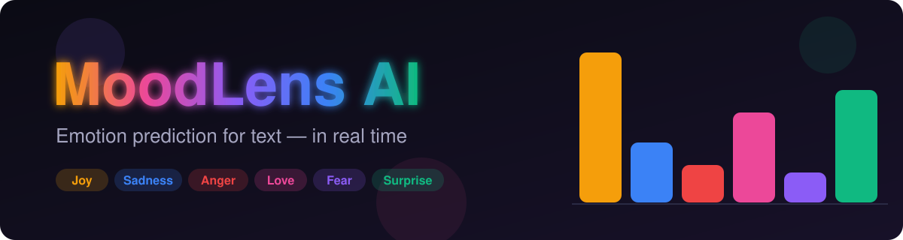
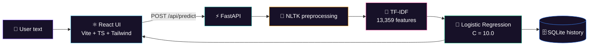

<div align="center">



<a href="https://github.com/your-username/emotion-predictor">
  
</a>

<br/>

[](https://fastapi.tiangolo.com/)
[](https://react.dev/)
[](https://www.typescriptlang.org/)
[](https://vitejs.dev/)
[](https://tailwindcss.com/)
[](https://scikit-learn.org/)
[](https://www.python.org/)

<br/>

**[Quick Start](#-quick-start)** &nbsp;•&nbsp;
**[Features](#-features)** &nbsp;•&nbsp;
**[How It Works](#-how-it-works)** &nbsp;•&nbsp;
**[API](#-api-reference)** &nbsp;•&nbsp;
**[Testing](#-testing)** &nbsp;•&nbsp;
**[Troubleshooting](#-troubleshooting)**

</div>

---

## 🧠 What is MoodLens AI?

**MoodLens AI** is an end-to-end, full-stack NLP application that reads a piece of text and tells you which emotion it expresses, along with a confidence score for every class.

It pairs a **FastAPI** backend serving a Multi-Class Logistic Regression model with a dark-mode **React + Vite + TypeScript + Tailwind** interface designed in **Google Stitch**.

<div align="center">

| 😄 Joy | 😢 Sadness | 😠 Anger | ❤️ Love | 😨 Fear | 😲 Surprise |
| :---: | :---: | :---: | :---: | :---: | :---: |
| `#F59E0B` | `#3B82F6` | `#EF4444` | `#EC4899` | `#8B5CF6` | `#10B981` |

</div>

### See it in action

```text
 INPUT   "I just received the acceptance letter for my dream master's program!"
   │
   ▼
 CLEAN   "received acceptance letter dream masters program"
   │
   ▼
 VECTOR  TF-IDF  →  13,359-dim sparse vector
   │
   ▼
 OUTPUT  😄 joy   ████████████████████ 98.42%
         😢 sadness ▏ 0.51%   😠 anger ▏ 0.42%   😲 surprise ▏ 0.34%
```

---

## ✨ Features

| | Feature | Details |
| :---: | :--- | :--- |
| 🤖 | **In-memory inference** | Fitted TF-IDF vectorizer (13,359 vocabulary) + L2-regularized Logistic Regression (`C=10.0`), loaded once at startup |
| 🔁 | **Preprocessing parity** | The inference pipeline mirrors training exactly, including NLTK stopword filtering, so there is no lexical mismatch |
| 📊 | **Probabilistic output** | Confidence scores across all 6 classes, summing to ≈ 1.0 |
| ⌨️ | **Interactive workspace** | Live character / word / n-gram counters, clipboard paste and clear, one-click presets |
| 🗄️ | **Persistent history** | SQLite (`backend/history.db`) keeps queries, predictions and timestamps across restarts |
| 🔎 | **Telemetry and filters** | Keyword search, emotion filters, multi-criteria sorting, **CSV export** |
| 🧭 | **5-stage pipeline explorer** | Visual walkthrough of the model lifecycle with parameter breakdowns |
| 💚 | **Live health badge** | Backend readiness indicator right in the navbar |

---

## 🧩 How It Works



### Training ↔ inference parity

The text goes through the same six steps in `main.ipynb` (training) and `backend/model_service.py` (inference):

1. Lowercasing
2. Punctuation removal (`string.punctuation`)
3. Numeric digit removal
4. URL removal via regex (`https?:\S+|www\.\S+`)
5. Emoji and non-ASCII stripping
6. Tokenization with NLTK `word_tokenize` and pruning against **198 English stopwords**

> [!IMPORTANT]
> Skipping or reordering any step shifts the features away from the 13,359 vocabulary dimensions in `tfidf_vectorizer.pkl`. Keep `model_service.py` in sync with the notebook.

---

## 🗂️ Project Structure

<details>
<summary><b>Click to expand the directory tree</b></summary>

```
emotion-predictor/
├── backend/                             # Python FastAPI service
│   ├── artifacts/
│   │   ├── best_lr_model.pkl            # Trained Logistic Regression model
│   │   ├── tfidf_vectorizer.pkl         # Fitted TF-IDF vectorizer
│   │   └── emotion_mapping.pkl          # Class label ↔ ID mapping
│   ├── main.py                          # FastAPI app and route handlers
│   ├── model_service.py                 # NLTK preprocessing + inference
│   ├── database.py                      # SQLite persistence and history
│   ├── requirements.txt
│   ├── test_backend.py                  # Integration test suite
│   └── history.db                       # Created on first launch
│
├── frontend/                            # React + Vite + TypeScript
│   ├── public/
│   ├── src/
│   │   ├── components/Navbar.tsx        # Header, connection badge, tabs
│   │   ├── views/
│   │   │   ├── HomeView.tsx             # Hero, sample pills, console wave
│   │   │   ├── AnalyzeWorkspaceView.tsx # Analysis workspace + result cards
│   │   │   ├── HistoryView.tsx          # Table, filters, search, CSV export
│   │   │   └── MethodologyView.tsx      # 5-stage pipeline + hyperparameters
│   │   ├── api.ts                       # Typed fetch client
│   │   ├── emotionMeta.ts               # Taxonomy, colors, presets
│   │   ├── App.tsx
│   │   ├── index.css
│   │   └── main.tsx
│   ├── package.json
│   ├── tailwind.config.js               # Design tokens and palette
│   ├── tsconfig.json
│   ├── .env.example
│   └── .env
│
├── stitch_moodlens_ai_platform/         # Raw Stitch design exports
├── assets/banner.svg                    # Animated README banner
├── main.ipynb                           # Original training notebook
├── README.md
└── .gitignore
```

</details>

---

## 🚀 Quick Start

**Prerequisites:** Python 3.10 – 3.12, Node.js 18+ (v20+ recommended), `pip` and `npm`.

Open **two terminals** in the project root.

### 1️⃣ Backend (FastAPI)

```powershell
cd backend

# Recommended: virtual environment
python -m venv .venv
.\.venv\Scripts\Activate.ps1      # Windows PowerShell
# source .venv/bin/activate       # macOS / Linux

pip install -r requirements.txt
uvicorn main:app --reload --port 8000
```

| Service | URL |
| :--- | :--- |
| API | http://localhost:8000 |
| Swagger docs | http://localhost:8000/docs |
| Health check | http://localhost:8000/api/health |

### 2️⃣ Frontend (React + Vite)

```powershell
cd frontend
npm install
npm run dev
```

Open **http://localhost:5173** and start analyzing. 🎉

---

## 📡 API Reference

| Method | Endpoint | Purpose |
| :---: | :--- | :--- |
| `GET` | `/api/health` | Model and service readiness |
| `POST` | `/api/predict` | Classify text and save to history |
| `GET` | `/api/history?limit=100&offset=0` | Paginated past predictions |
| `DELETE` | `/api/history` | Clear all history |
| `GET` | `/api/stats` | Aggregate telemetry |

<details open>
<summary><b>POST /api/predict</b></summary>

**Request**
```json
{ "text": "I just received the acceptance letter for my dream master's program!" }
```

**Response `200 OK`**
```json
{
  "predicted_emotion": "joy",
  "confidence": 0.9842,
  "probabilities": {
    "sadness": 0.0051,
    "anger": 0.0042,
    "love": 0.0018,
    "surprise": 0.0034,
    "fear": 0.0013,
    "joy": 0.9842
  },
  "cleaned_text": "received acceptance letter dream masters program",
  "tokens_count": 5,
  "history_id": 1
}
```
Empty or whitespace-only text returns **`422`**.
</details>

<details>
<summary><b>GET /api/health</b></summary>

```json
{
  "status": "healthy",
  "model_loaded": true,
  "classes": ["sadness", "anger", "love", "surprise", "fear", "joy"],
  "artifacts_dir": "C:\\emotion predictor\\backend\\artifacts",
  "error": null
}
```
</details>

<details>
<summary><b>GET /api/history</b></summary>

```json
[
  {
    "id": 1,
    "text": "I just received the acceptance letter for my dream master's program!",
    "predicted_emotion": "joy",
    "confidence": 0.9842,
    "probabilities": { "joy": 0.9842, "sadness": 0.0051, "anger": 0.0042, "love": 0.0018, "surprise": 0.0034, "fear": 0.0013 },
    "created_at": "2026-10-19T22:45:00.000Z"
  }
]
```
</details>

<details>
<summary><b>DELETE /api/history</b></summary>

```json
{ "status": "success", "message": "Cleared 1 history records", "deleted_count": 1 }
```
</details>

<details>
<summary><b>GET /api/stats</b></summary>

```json
{ "total_records": 1, "avg_confidence": 0.9842, "dominant_emotion": "joy", "dominant_count": 1 }
```
</details>

Quick test from the command line:

```bash
curl -X POST http://localhost:8000/api/predict \
  -H "Content-Type: application/json" \
  -d '{"text": "I am so scared of what happens next"}'
```

---

## ⚙️ Configuration

| Where | Variable | Default | Description |
| :--- | :--- | :--- | :--- |
| `frontend/.env` | `VITE_API_BASE_URL` | `http://localhost:8000` | Backend base URL |
| Backend env | `CORS_ORIGINS` | `http://localhost:5173,http://127.0.0.1:5173` | Comma-separated allowed origins |

---

## ✅ Testing

```powershell
python backend/test_backend.py
```

| # | Check | Result |
| :-: | :--- | :--- |
| 1 | Model and vectorizer load once at startup | ✅ |
| 2 | `/api/health` returns 200 with all 6 classes | ✅ |
| 3 | Probabilities sum to 1.0000 ± 0.001 | ✅ |
| 4 | Empty / whitespace input rejected with 422 | ✅ |
| 5 | SQLite write, read and clear | ✅ |
| 6 | `npm run build` compiles with no TypeScript or Vite errors | ✅ |

**Sample accuracy checks**

| Emotion | Confidence |
| :--- | :--- |
| 😄 Joy | 99.92% |
| 😢 Sadness | 100.00% |
| 😠 Anger | 99.58% |
| ❤️ Love | 98.43% |
| 😨 Fear | 94.63% |
| 😲 Surprise | 95.76% |

---

## 🛠️ Troubleshooting

<details>
<summary><b>PowerShell blocks the venv activation script</b></summary>

```powershell
Set-ExecutionPolicy -Scope Process -ExecutionPolicy Bypass
.\.venv\Scripts\Activate.ps1
```
</details>

<details>
<summary><b>Missing NLTK data (offline machines)</b></summary>

`model_service.py` downloads `punkt_tab` and `stopwords` on startup. If you are offline:

```python
import nltk
nltk.download('punkt')
nltk.download('punkt_tab')
nltk.download('stopwords')
```
</details>

<details>
<summary><b>Port 8000 is already in use</b></summary>

```powershell
uvicorn main:app --reload --port 8080
```
Then update `frontend/.env`:
```env
VITE_API_BASE_URL=http://localhost:8080
```
</details>

<details>
<summary><b>Frontend shows the backend as offline</b></summary>

Check that the backend is running, that `VITE_API_BASE_URL` matches its port, and that your frontend origin is listed in `CORS_ORIGINS`.
</details>

---

## 🗺️ Roadmap

- [ ] Transformer baseline (e.g. DistilBERT) for comparison with TF-IDF + LR
- [ ] Batch prediction endpoint
- [ ] Docker Compose for one-command startup
- [ ] Model evaluation dashboard (confusion matrix, per-class F1)

---

## 🙏 Acknowledgments

- **Dataset:** multi-class emotion dataset with ~16,000 annotated text samples
- **Design:** Google Stitch MoodLens AI design system (dark obsidian theme, Plus Jakarta Sans and Inter)
- **Stack:** FastAPI async runtime paired with React + Vite

<div align="center">


⭐ If you found this useful, consider starring the repo!

</div>
